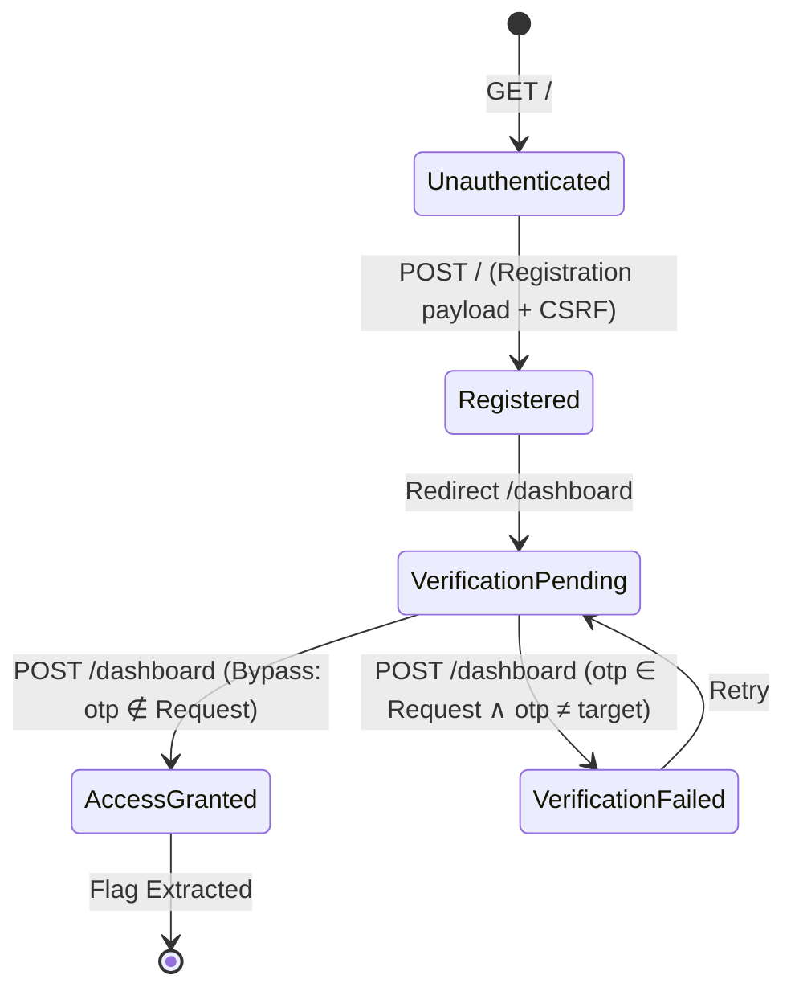

# Mathematical and Structural Analysis: IntroToBurp (#419)

## 1. Problem Context & Configuration

- **Challenge Name:** IntroToBurp
- **Challenge ID:** #419
- **Category:** Web Exploitation
- **Target Endpoint (from [`connection.cfg`](file:///Users/lowkeyprod/Documents/USTH/CTF/cylab/challenges/Web_Exploitation/IntroToBurp/connection.cfg)):**
  - Host: `chatelaine.cylabacademy.net`
  - Port: `49123`
  - Base URL: `http://chatelaine.cylabacademy.net:49123`

---

## 2. State Machine & Flow Model

The application models a multi-step user onboarding and two-factor authentication (2FA) workflow.



### Protocol Interaction Sequences
1. **Registration Phase ($S_0 \to S_1$):**
   - Client sends initial registration state tuple:
     $$\mathcal{R}_{init} = \langle csrf\_token, full\_name, username, phone\_number, city, password \rangle$$
   - Backend establishes session state $\mathcal{S}_{sess} = \langle username, authenticated=False, pending\_2fa=True \rangle$.

2. **Verification Phase ($S_1 \to S_2$):**
   - Client issues POST request to `/dashboard` with parameter set $\mathcal{P}_{req}$.

---

## 3. Formal Logic & Constraint Analysis

### 3.1 Ideal vs. Flawed Predicates

Let:
- $\mathcal{P}$ denote the set of keys in the incoming request body (e.g. form-encoded data).
- $otp_{sub} = \mathcal{V}(\text{'otp'})$ denote the value submitted under the key `'otp'`.
- $otp_{actual}$ denote the cryptographically generated one-time code stored in the session context.

#### Correct Security Invariant
An authorization barrier requiring two-factor validation must satisfy the strict conjunction:
$$\Phi_{secure}(req) \iff (\text{'otp'} \in \mathcal{P}) \land (otp_{sub} == otp_{actual})$$
Access is granted if and only if $\Phi_{secure}(req) = \text{True}$.

#### Flawed Implementation Predicate
The vulnerable server checks validation through an exception-rejection model with incomplete branch coverage:
$$\Phi_{reject}(req) \iff (\text{'otp'} \in \mathcal{P}) \land (otp_{sub} \neq otp_{actual})$$
Access control evaluation:
$$\text{Decision}(req) = \begin{cases} 
\text{Reject}, & \text{if } \Phi_{reject}(req) \\ 
\text{Grant}, & \text{otherwise} 
\end{cases}$$

### 3.2 Truth Table of Evaluation Branches

| Condition $A$: $\text{'otp'} \in \mathcal{P}$ | Condition $B$: $otp_{sub} == otp_{actual}$ | Correct Policy $\Phi_{secure}$ | Flawed Policy $\neg \Phi_{reject}$ | System Behavior |
| :---: | :---: | :---: | :---: | :---: |
| $\text{True}$ | $\text{True}$ | $\text{True}$ | $\text{True}$ | Access Granted (Valid 2FA) |
| $\text{True}$ | $\text{False}$ | $\text{False}$ | $\text{False}$ | Access Denied ("Invalid OTP") |
| $\text{False}$ | N/A | $\text{False}$ | **$\text{True}$** | **Access Granted (Auth Bypass)** |

When the key `'otp'` is omitted from the request body:
$$\mathcal{P}_{mal} = \emptyset \implies (\text{'otp'} \in \mathcal{P}_{mal}) = \text{False}$$
$$\Phi_{reject}(\mathcal{P}_{mal}) = \text{False} \land \text{undefined} = \text{False}$$
$$\text{Decision}(\mathcal{P}_{mal}) = \text{Grant}$$

---

## 4. Complexity & Parameter Space

- **Brute-Force Complexity (Normal Mode):**
  Assuming a 4-digit numeric OTP space:
  $$|\mathcal{S}_{OTP}| = 10^4 = 10,000$$
  Or 6-digit numeric OTP:
  $$|\mathcal{S}_{OTP}| = 10^6 = 1,000,000$$
- **Bypass Complexity via Parameter Omission:**
  $$\mathcal{O}(1)$$
  A single HTTP POST transaction with empty body or body devoid of `'otp'` satisfies $\neg \Phi_{reject}$.

---

## 5. Defensive Remediation & Verification

### Insecure Pattern
```python
# Vulnerable conditional structure
if 'otp' in request.form:
    if request.form['otp'] != session.get('otp'):
        return render_template('dashboard.html', error="Invalid OTP")
return render_template('dashboard.html', flag=FLAG)
```

### Remediated Pattern
```python
# Secure conditional structure
submitted_otp = request.form.get('otp')
expected_otp = session.get('otp')

if not submitted_otp or not expected_otp or not secrets.compare_digest(submitted_otp, expected_otp):
    return render_template('dashboard.html', error="Invalid or missing OTP"), 403

session['2fa_verified'] = True
return render_template('dashboard.html', flag=FLAG)
```
